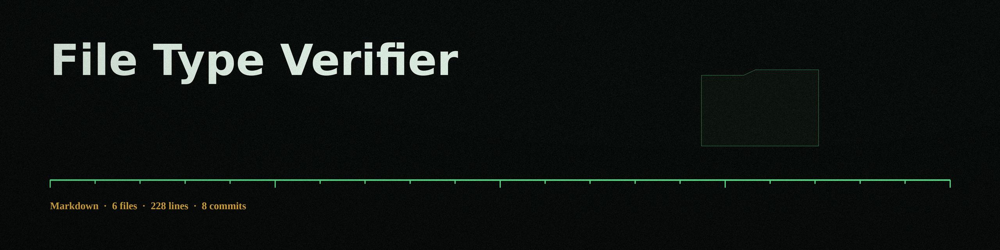

# file-type-verifier

Compares the opening bytes of a file against the known signatures for jpg, png, gif, and pdf, and reports whether the file starts with the signature of the type named with `--expected-type`. For gif, both the GIF87a and GIF89a signatures are accepted.

That is all the tool does. Content after the opening bytes is never inspected: a file that starts with a valid signature and holds anything at all after it still verifies. The tool does not scan content, does not check paths beyond opening the file the operator names, and makes no claim about what a file is beyond its opening bytes.

## Install

Clone this repository, then run the tool with Python 3. The tool uses only the Python standard library. There are no third party dependencies.

## Usage

`python3 main.py <file> --expected-type <jpg|png|gif|pdf>`

## Parameters

- `file`: Path to the file to be verified.
- `--expected-type`: Expected file type (jpg, png, gif, or pdf). Required.
- `--verbose`: Enable verbose logging.
- `-h`: Show help message and exit.

## Exit codes

Exit 0 means the opening bytes match the expected type signature. Exit 1 means they do not match, or the path is not a valid file.

## License

Copyright (c) ShadowGuardAI. See the LICENSE file in this repo.
